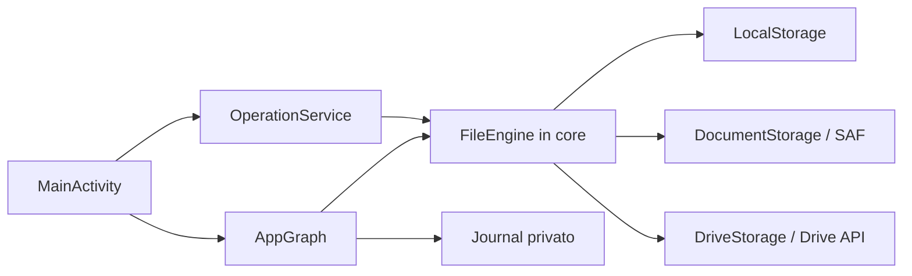

# Architettura — Gestore File

## Stack e moduli

- Android nativo, Kotlin 2.1.21, Gradle 8.9, Android Gradle Plugin 8.7.3, JDK 17, SDK 35; `minSdk 30`, `targetSdk 35` (configurazione in `app/build.gradle.kts`).
- `core/` è una libreria Kotlin/JVM senza dipendenze Android. `Storage` astrae le operazioni; `FileEngine` applica trasferimenti, conflitti, annullamento, verifica e rollback. `Journal`, `Trash` e `Tools` forniscono registro, cestino locale e utility.
- `app/` contiene `MainActivity`, `AppGraph`, servizio foreground delle operazioni, permessi, dialoghi, apertura/condivisione, aggiornamenti e adapter di storage.
- Provider: filesystem locale (`LocalStorage`), Android Storage Access Framework (`DocumentStorage`) e Google Drive (`DriveApi`, `DriveStorage`, `DriveAccounts`). L’app usa interfaccia Android nativa con liste/griglie; non è una WebView.

## Flussi e dati

Le letture UI sono asincrone e le scritture sono serializzate nel servizio operazioni. Il core copia in staging, verifica contenuti e sorgenti dove previsto, poi pubblica la destinazione; il move elimina l’origine solo dopo controlli. Su filesystem locale è usata la rinomina atomica quando disponibile; SAF non garantisce atomicità generale. Incertezze sono registrate per recupero manuale, non risolte cancellando automaticamente file.

Preferiti, recenti, journal e dati di recupero risiedono nell’area privata dell’app; il cestino locale è nella cartella `.LiberoFilesTrash` della memoria interna. I documenti dell’utente non vengono caricati su un backend. Drive comunica direttamente con Google tramite API e autorizzazione Android; è opzionale e soggetto alla configurazione OAuth. Nessun database applicativo o server proprio è presente.

## Rete, autenticazione e aggiornamenti

Internet serve al controllo/download aggiornamenti e, solo se abilitato e autorizzato, a Google Drive. Il manifest include `INTERNET`, `REQUEST_INSTALL_PACKAGES` e `MANAGE_EXTERNAL_STORAGE`; l’accesso alla memoria richiede consenso Android. USB è concesso tramite selettore SAF. L’installer Android richiede conferma dell’utente. Il canale di distribuzione, verifica APK e firma sono descritti nel README e negli script `scripts/package-release.mjs` e `scripts/verify-release.mjs`.

## Build e decisioni osservabili

Il core separa le regole di integrità dai provider, permettendo test JVM e adattatori diversi. Le copie streaming limitano l’uso di memoria; le operazioni sequenziali semplificano conflitti e annullamento. Le verifiche forti e gli hash aumentano le letture e quindi il tempo d’operazione. Non ci sono benchmark dichiarati su dispositivi reali.

Build documentata: `gradlew.bat :core:test :app:testDebugUnitTest :app:lintDebug :app:assembleRelease`. GitHub Actions verifica codice e release e pubblica il sito `docs/` (vedi `.github/workflows`). La configurazione è candidata: la disponibilità pubblica di Drive non va dedotta dalla sola presenza dell’adapter.
